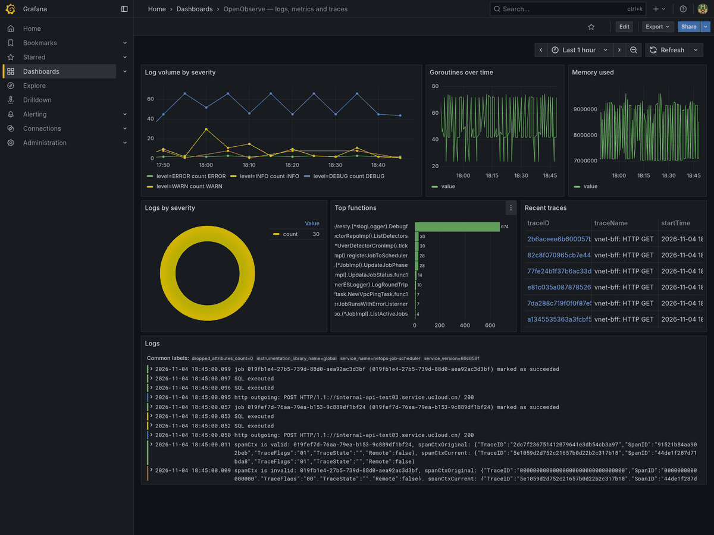
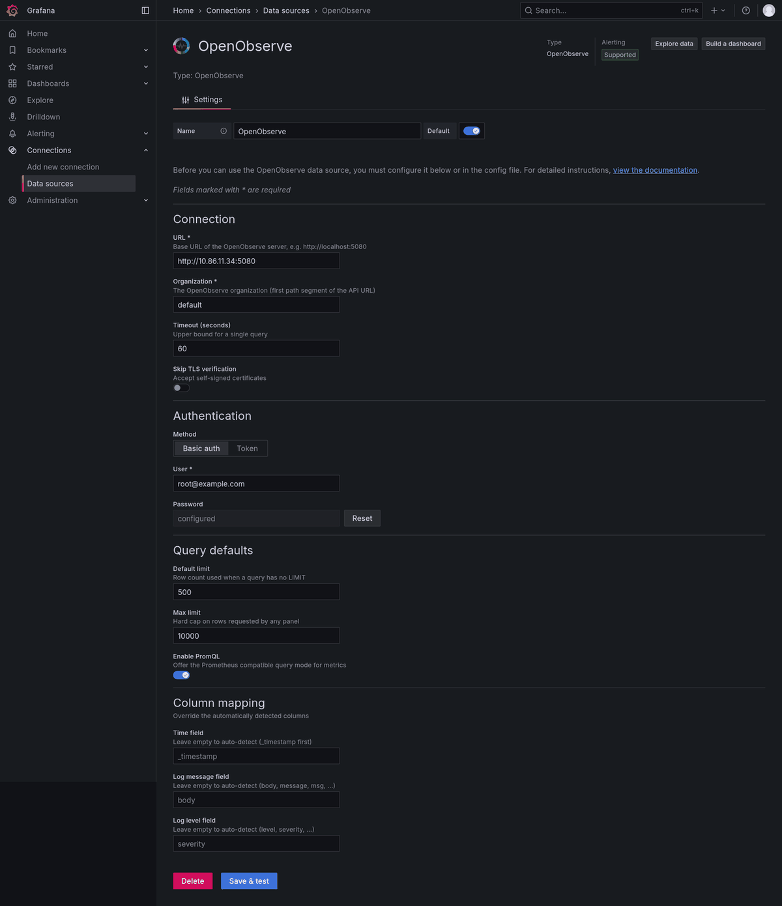
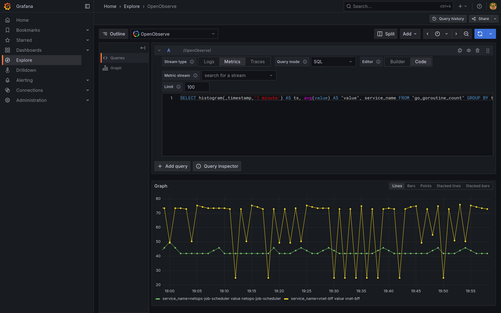
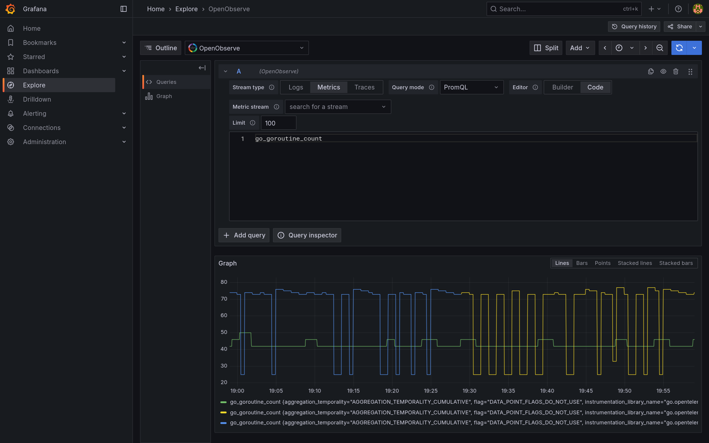
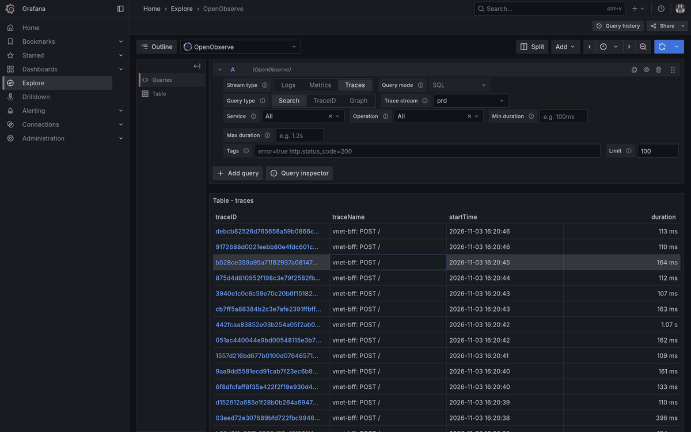
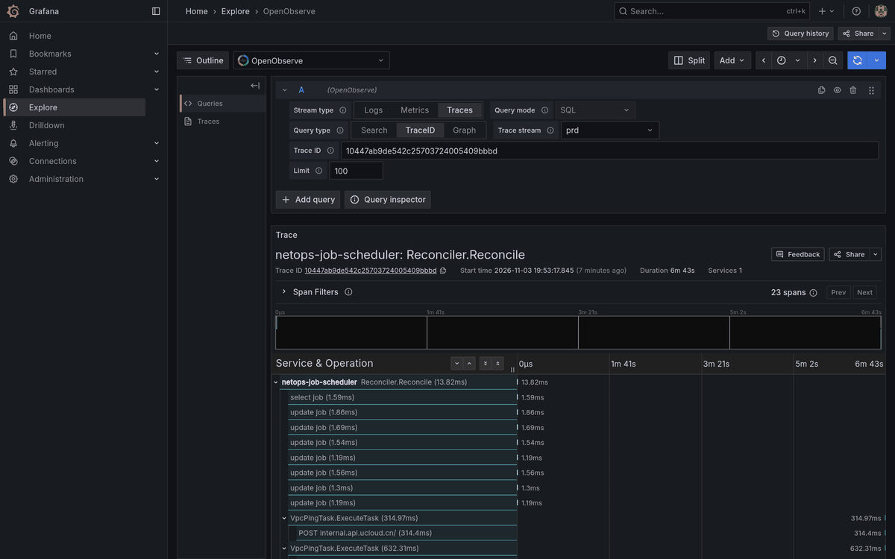
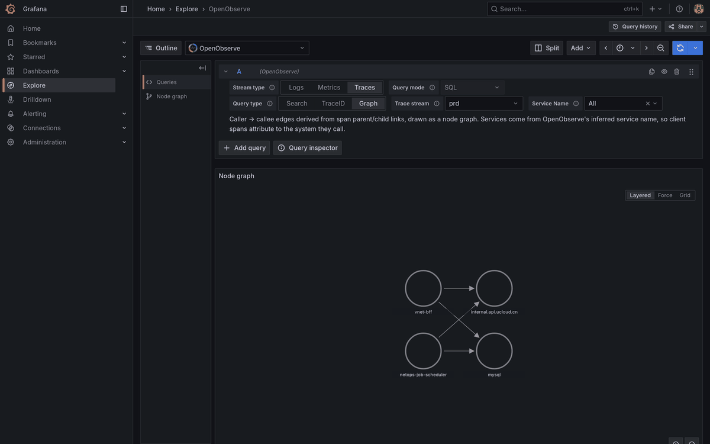

# OpenObserve

A Grafana data source for [OpenObserve](https://github.com/openobserve/openobserve):
query **logs**, **metrics** and **traces** with SQL, or use **PromQL** against
OpenObserve's Prometheus compatible API, and put the results straight into panels,
dashboards, variables and annotations.

This plugin is community maintained. It aims to feel native to Grafana rather than
exposing the raw API: frames are shaped the way Grafana expects, so logs get level
colours, `GROUP BY` becomes series labels, and spans draw the native trace
waterfall without transformations.



## Requirements

|              |                                                                  |
| ------------ | ---------------------------------------------------------------- |
| Grafana      | 10.4.0 or newer (tested up to 13.x)                              |
| OpenObserve  | 0.14.7 or newer, self-hosted or Cloud                            |
| Connectivity | the Grafana **server** must be able to reach the OpenObserve URL |

## Getting started

1. Install the plugin from the Grafana catalogue, or unpack a release archive into
   `/var/lib/grafana/plugins/`. A manually installed, unsigned build needs
   `GF_PLUGINS_ALLOW_LOADING_UNSIGNED_PLUGINS=linpr-openobserve-datasource` in the
   Grafana environment.
2. Add a data source of type **OpenObserve** and fill in:
   - **URL** — your OpenObserve base URL, e.g. `http://localhost:5080`
   - **Organization** — usually `default`
   - **Authentication** — basic auth (user + password) or a token, sent verbatim in
     the `Authorization` header (both `Basic <base64>` and `Bearer <jwt>` work)
   - **Default / max limit** — row count when the SQL has no `LIMIT`, and the hard cap
3. **Save & test** reports the organization it reached and how many log streams it
   found.



## Query

Pick a stream type (`logs`, `metrics`, `traces`), then write SQL:

```sql
SELECT * FROM "my_logs" LIMIT 500
```

```sql
SELECT histogram(_timestamp, '1 minute') AS ts,
       avg(value) AS value,
       service_name
FROM "go_goroutine_count"
GROUP BY ts, service_name
ORDER BY ts
```

The editor has a **Builder** mode that derives the SQL from structured inputs, with
a read-only preview of the statement that will run, and a **Code** mode with
completion for stream names and columns. Switching between them never loses work.

For metric streams, switch **Query mode** to `PromQL` to use OpenObserve's
Prometheus compatible API, so `rate()`, `histogram_quantile()` and label matchers
behave like a native Prometheus data source.

| Metrics over SQL                                                                                                                             | PromQL                                                                                                                        |
| -------------------------------------------------------------------------------------------------------------------------------------------- | ----------------------------------------------------------------------------------------------------------------------------- |
|  |  |

## Traces

The trace editor offers three query types — **Search** (list matching traces),
**TraceID** (one trace as the Grafana waterfall) and **Graph** (service dependency
graph derived from span parent links).

| Search                                                                                                                            | TraceID (waterfall)                                                                                                                     | Graph                                                                                                                           |
| --------------------------------------------------------------------------------------------------------------------------------- | --------------------------------------------------------------------------------------------------------------------------------------- | ------------------------------------------------------------------------------------------------------------------------------- |
|  |  |  |

## Features

- **Result formats** — `Auto`, `Logs`, `Table`, `Time series`, `Trace`, `Annotations`
- **SSE streaming search** (`_search_stream`), with automatic fallback to plain JSON
- **Automatic time columns** — `_timestamp` (µs), `start_time` (ns) and ISO strings
  all become Grafana time fields, so no `AS gf_time` or transformations are needed
- **Series labels** — grouping columns become legend entries
- **Native logs and trace frames** — level colours, full attribute details, and a
  waterfall drawn by Grafana itself
- **Schema-aware typing** — columns are typed from the stream schema, with a
  value-based cross-check so a computed alias never gets the wrong type
- **Ad-hoc filters** injected server side as real SQL predicates, with values
  escaped and `=~` / `!~` translated to OpenObserve's `~` / `!~`
- **Template variables** with quote-aware SQL formatting and multi-value support
- **Actionable errors** — the OpenObserve error body is surfaced, and a stream type
  mismatch explains itself instead of showing a blank panel

## Documentation

- [Feature guide](https://github.com/LinPr/grafana-openobserve-datasource/blob/main/doc/features.md)
- [Installation, upgrade and troubleshooting](https://github.com/LinPr/grafana-openobserve-datasource/blob/main/README.md)
- [Changelog](https://github.com/LinPr/grafana-openobserve-datasource/blob/main/CHANGELOG.md)

## Support

- [Issues and feature requests](https://github.com/LinPr/grafana-openobserve-datasource/issues)
- [中文说明](https://github.com/LinPr/grafana-openobserve-datasource/blob/main/README.zh-CN.md)

## License

Apache License 2.0 — see
[LICENSE](https://github.com/LinPr/grafana-openobserve-datasource/blob/main/LICENSE).
